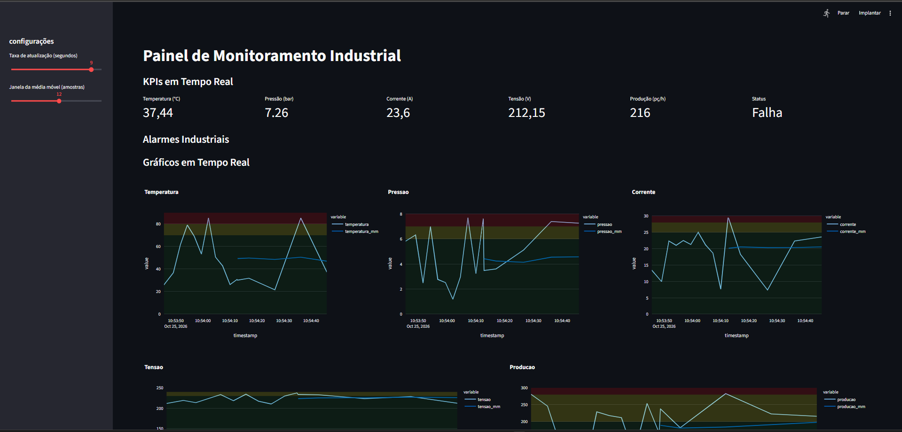
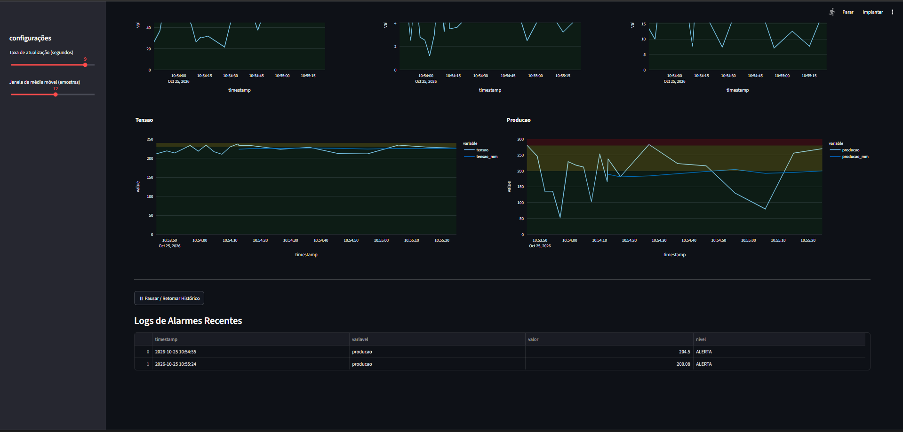

# Monitoramento Industrial com Python e Streamlit

Supervisório web para **simulação de monitoramento industrial**, desenvolvido em Python com Streamlit. Exibe indicadores, gráficos e alarmes para explorar conceitos de Indústria 4.0. Os dados são simulados; a aplicação atual não possui conexão com sensores ou CLPs.

## Visualização do supervisório

### Indicadores e gráficos em tempo real



### Histórico e alarmes



As capturas mostram a aplicação em execução. Os valores variam a cada atualização porque são gerados por simulação.

## Funcionalidades

- KPIs de temperatura (°C), pressão (bar), corrente (A), tensão (V), produção (pç/h) e status da máquina.
- Gráficos interativos com dados brutos, média móvel e faixas de operação.
- Atualização configurável entre 1 e 10 segundos e média móvel entre 3 e 20 amostras.
- Alarmes calculados sobre a média móvel, com níveis normal, alerta e crítico.
- Registro de mudanças para estados de alerta e crítico e exibição dos 10 eventos mais recentes.
- Histórico limitado a 1.000 registros por sessão, com pausa e retomada; os KPIs continuam atualizando durante a pausa.
- Registro de notificações em arquivo e integração implementada com Telegram e e-mail SMTP.

## Tecnologias

- Python
- [Streamlit](https://docs.streamlit.io/) — interface web.
- Pandas — histórico e média móvel.
- Plotly — gráficos interativos.
- Requests — envio de mensagens ao Telegram.

## Executar localmente

Na pasta do repositório, crie um ambiente virtual e instale as dependências:

```powershell
python -m venv .venv
.\.venv\Scripts\python.exe -m pip install -r requirements.txt
```

Antes de executar, revise `NOTIFICACOES` em `config/settings.py`: o fluxo de alarmes chama o envio ao Telegram automaticamente, e o e-mail depende de `ativo`. Configure apenas destinos que deseja utilizar. As credenciais são lidas das variáveis de ambiente `TELEGRAM_BOT_TOKEN`, `TELEGRAM_CHAT_ID`, `SMTP_USER`, `SMTP_PASSWORD` e `SMTP_TO`. Sem token ou chat configurados, o envio ao Telegram é ignorado.

Inicie o painel:

```powershell
.\.venv\Scripts\python.exe -m streamlit run app.py
```

Acesse o endereço informado no terminal, normalmente `http://localhost:8501`. Use a barra lateral para ajustar a atualização e a média móvel. Aguarde a quantidade de amostras selecionada para visualizar a média móvel e avaliar os alarmes.

## Estrutura do repositório

```text
industrial-monitoring/
├── app.py                         # Interface e ciclo de atualização
├── notifications.py               # Logs, Telegram e e-mail
├── config/
│   └── settings.py                # Limites e configurações
├── data/
│   └── simulated_data.py          # Geração das amostras simuladas
├── docs/
│   └── images/                    # Capturas usadas neste README
├── requirements.txt               # Dependências diretas
├── .gitignore                     # Arquivos locais e gerados
└── README.md
```

A estrutura modular atual atende ao tamanho do projeto. Backups antigos foram omitidos da publicação; use o histórico do Git para acompanhar versões futuras.

## Configurações e comportamento atual

Em `config/settings.py`:

| Configuração | Finalidade |
| --- | --- |
| `LIMITES` | Limiares de alerta e crítico e intervalos da simulação |
| `DASHBOARD` | Atualização padrão, janela da média móvel e limite do histórico |
| `CENARIOS` | Cenários utilizados pelo gerador de dados |
| `NOTIFICACOES` | Destinos, arquivo de log e intervalo mínimo entre notificações iguais |

Os alarmes atuais verificam se a média móvel ultrapassa os limites superiores, inclusive para produção. O status da máquina é sorteado pelo simulador. Histórico e eventos da interface ficam na sessão do Streamlit; as notificações também são gravadas em `logs/eventos.log`.

## Pendências de organização

- Revogar as credenciais usadas em versões locais anteriores. Esta publicação começa com histórico novo e configuração por variáveis de ambiente.
- Manter caches Python, logs e credenciais locais fora do versionamento, conforme o `.gitignore`.
- Consolidar uma versão de Python e fixar versões de dependências após validar o ambiente escolhido. O `requirements.txt` lista as dependências diretas sem fixar versões.
