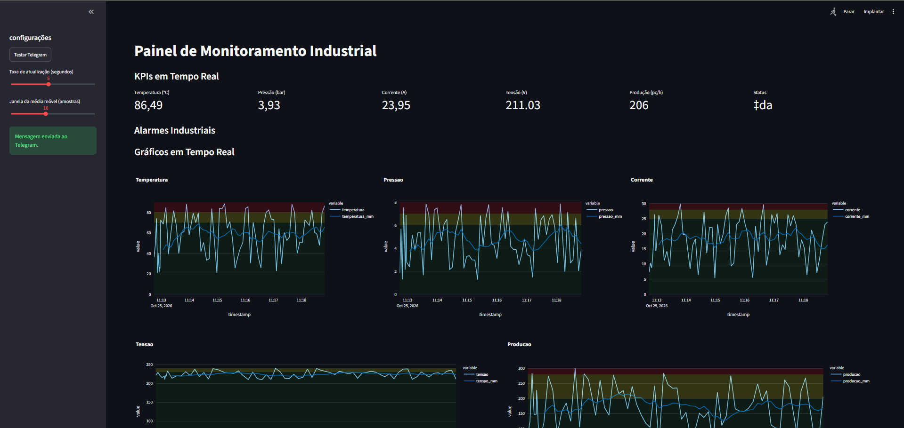
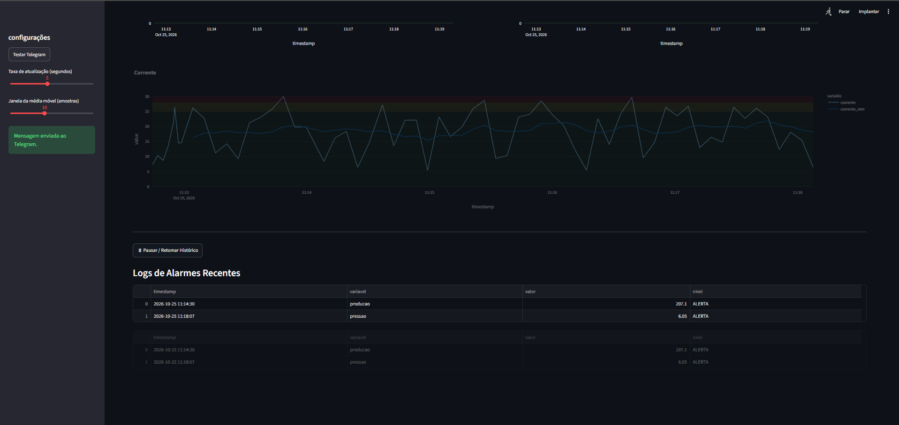
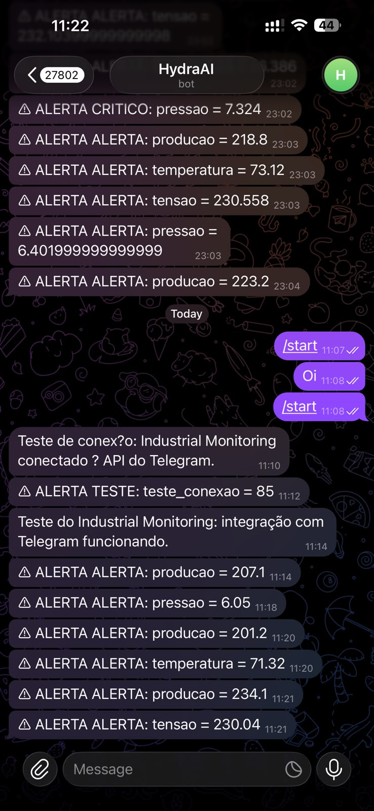

# Monitoramento Industrial com Python e Streamlit

Supervisório web para **simulação de monitoramento industrial**, desenvolvido em Python com Streamlit. Exibe indicadores, gráficos e alarmes para explorar conceitos de Indústria 4.0. Os dados são simulados; a aplicação atual não possui conexão com sensores ou CLPs.

## Visualização do supervisório

### Indicadores e gráficos em tempo real


### Histórico e alarmes


As capturas mostram a aplicação em execução. Os valores variam a cada atualização porque são gerados por simulação.

### Demonstração da integração com Telegram





<p align="center">
  
</p>

As fotos ilustram uma execução de demonstração com Telegram. O nome do bot exibido é apenas uma referência visual: crie seu próprio bot e configure seu próprio destino. Nenhum token ou identificador real é necessário nos exemplos abaixo. Alguns elementos das capturas, como o botão de teste, pertencem à versão usada na demonstração e podem diferir do código publicado.

## Funcionalidades

- KPIs de temperatura (°C), pressão (bar), corrente (A), tensão (V), produção (pç/h) e status da máquina.
- Gráficos interativos com dados brutos, média móvel e faixas de operação.
- Atualização configurável entre 1 e 10 segundos e média móvel entre 3 e 20 amostras.
- Alarmes calculados sobre a média móvel, com níveis normal, alerta e crítico.
- Registro de mudanças para estados de alerta e crítico e exibição dos 10 eventos mais recentes.
- Histórico limitado a 1.000 registros por sessão, com pausa e retomada; os KPIs continuam atualizando durante a pausa.
- Registro de notificações em arquivo e integração implementada com Telegram e e-mail SMTP.

## Tecnologias

- Python
- [Streamlit](https://docs.streamlit.io/) — interface web.
- Pandas — histórico e média móvel.
- Plotly — gráficos interativos.
- Requests — envio de mensagens ao Telegram.

## Executar localmente

Pré-requisitos: Python, Git e acesso à internet para instalar as dependências. No PowerShell, clone o projeto:

```powershell
git clone https://github.com/eusales/industrial-monitoring.git
cd industrial-monitoring
```

Na pasta do repositório, crie um ambiente virtual e instale as dependências:

```powershell
python -m venv .venv
.\.venv\Scripts\python.exe -m pip install -r requirements.txt
```

Antes de executar, revise `NOTIFICACOES` em `config/settings.py`: o fluxo de alarmes chama o envio ao Telegram automaticamente, e o e-mail depende de `ativo`. Configure apenas destinos que deseja utilizar. As credenciais são lidas das variáveis de ambiente `TELEGRAM_BOT_TOKEN`, `TELEGRAM_CHAT_ID`, `SMTP_USER`, `SMTP_PASSWORD` e `SMTP_TO`. Sem token ou chat configurados, o envio ao Telegram é ignorado.

Inicie o painel:

```powershell
.\.venv\Scripts\python.exe -m streamlit run app.py
```

Acesse o endereço informado no terminal, normalmente `http://localhost:8501`. Use a barra lateral para ajustar a atualização e a média móvel. Aguarde a quantidade de amostras selecionada para visualizar a média móvel e avaliar os alarmes.

## Executar com notificações no Telegram (exemplo genérico)

### 1. Criar seu bot e iniciar a conversa

No Telegram, abra o [BotFather](https://t.me/BotFather), envie `/newbot` e siga as instruções. Guarde o token recebido somente no seu ambiente local. Abra a conversa com o bot criado e envie `/start`. Consulte o [tutorial oficial do Telegram](https://core.telegram.org/bots/tutorial).

### 2. Definir as variáveis de ambiente

No mesmo PowerShell que será usado para executar a aplicação, configure seus valores. Os textos abaixo são marcadores fictícios; substitua-os localmente:

```powershell
$env:TELEGRAM_BOT_TOKEN = "SEU_TOKEN_DO_BOT"
$env:TELEGRAM_CHAT_ID = "SEU_CHAT_ID"
```

Para descobrir o ID de uma conversa privada, após enviar `/start` ao seu bot, defina o token acima e consulte as atualizações:

```powershell
$updates = Invoke-RestMethod -Uri "https://api.telegram.org/bot$($env:TELEGRAM_BOT_TOKEN)/getUpdates"
$updates.result | ForEach-Object { $_.message.chat } | Select-Object id, type
```

Copie o `id` da sua conversa para `TELEGRAM_CHAT_ID`. Se não houver resultados, envie uma nova mensagem ao bot e repita a consulta. O método `getUpdates` não funciona enquanto houver um webhook configurado; use um bot dedicado para este exemplo. Referência: [getUpdates na Bot API](https://core.telegram.org/bots/api#getupdates).

As variáveis definidas com `$env:` valem para o terminal atual e os processos iniciados nele. O projeto lê o ambiente com `os.getenv`; criar um arquivo `.env` sozinho não carrega essas variáveis.

### 3. Testar a conexão

Com as dependências instaladas, envie uma mensagem de teste ao destino que você configurou:

```powershell
$body = @{
    chat_id = $env:TELEGRAM_CHAT_ID
    text = "Teste do Industrial Monitoring: integração com Telegram funcionando."
}
$response = Invoke-RestMethod -Method Post -Uri "https://api.telegram.org/bot$($env:TELEGRAM_BOT_TOKEN)/sendMessage" -Body $body
$response.ok
```

O resultado esperado é `True`, com a mensagem aparecendo na conversa. Esse teste usa a [API sendMessage](https://core.telegram.org/bots/api#sendmessage) diretamente e não depende de existir um botão de teste na interface.

### 4. Iniciar o supervisório

No mesmo terminal:

```powershell
.\.venv\Scripts\python.exe -m streamlit run app.py
```

Ajuste a janela da média móvel e aguarde a quantidade necessária de amostras. Quando a média de uma variável passar para alerta ou crítico, a aplicação registra o evento e tenta enviar a notificação. Exemplo ilustrativo:

```text
⚠ ALERTA ALERTA: pressao = 6.05
⚠ ALERTA CRITICO: temperatura = 82.4
```

Os valores são simulados, portanto os alarmes não aparecem em horários fixos. O intervalo mínimo configurado entre notificações iguais é de 60 segundos; o registro depende também da mudança de estado da variável. Sem as variáveis do Telegram, o painel continua funcionando e ignora esse envio. Mantenha tokens reais fora do README, de capturas e dos commits.

## Estrutura do repositório

```text
industrial-monitoring/
├── app.py                         # Interface e ciclo de atualização
├── notifications.py               # Logs, Telegram e e-mail
├── config/
│   └── settings.py                # Limites e configurações
├── data/
│   └── simulated_data.py          # Geração das amostras simuladas
├── docs/
│   └── images/                    # Capturas usadas neste README
├── requirements.txt               # Dependências diretas
├── .gitignore                     # Arquivos locais e gerados
└── README.md
```

A estrutura modular atual atende ao tamanho do projeto. Backups antigos foram omitidos da publicação; use o histórico do Git para acompanhar versões futuras.

## Configurações e comportamento atual

Em `config/settings.py`:

| Configuração | Finalidade |
| --- | --- |
| `LIMITES` | Limiares de alerta e crítico e intervalos da simulação |
| `DASHBOARD` | Atualização padrão, janela da média móvel e limite do histórico |
| `CENARIOS` | Cenários utilizados pelo gerador de dados |
| `NOTIFICACOES` | Destinos, arquivo de log e intervalo mínimo entre notificações iguais |

Os alarmes atuais verificam se a média móvel ultrapassa os limites superiores, inclusive para produção. O status da máquina é sorteado pelo simulador. Histórico e eventos da interface ficam na sessão do Streamlit; as notificações também são gravadas em `logs/eventos.log`.

## Pendências de organização

- Revogar as credenciais usadas em versões locais anteriores. Esta publicação começa com histórico novo e configuração por variáveis de ambiente.
- Manter caches Python, logs e credenciais locais fora do versionamento, conforme o `.gitignore`.
- Consolidar uma versão de Python e fixar versões de dependências após validar o ambiente escolhido. O `requirements.txt` lista as dependências diretas sem fixar versões.
